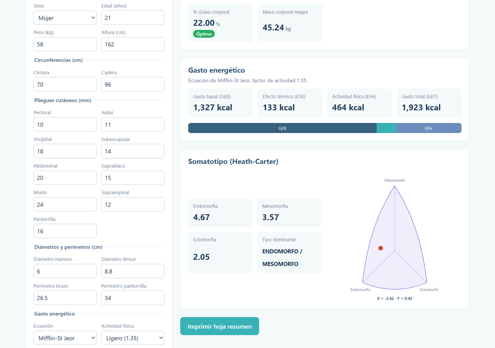
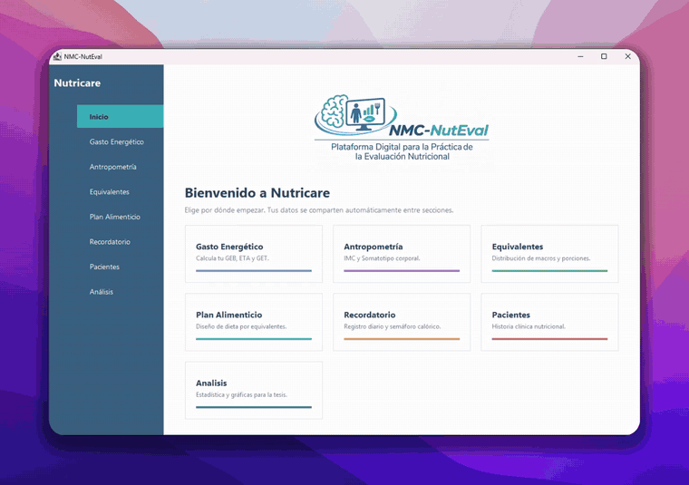
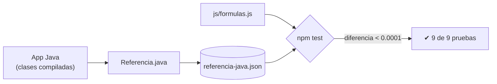

<div align="center">

# NutEval · Demo web

**Calculadora de evaluación nutricional, llevada del escritorio (Java Swing) al navegador.**

[**▶ Probar la demo**](https://nuteval-demo-web.vercel.app) · [Ver el video](#-la-app-de-escritorio) · [Cómo se verificó](#-mismos-resultados-que-java)




</div>

---

## Sobre el proyecto

**NutEval** es una aplicación de escritorio para la evaluación nutricional. Se desarrolló en Java como proyecto de **servicio social (BUAP)**. Tiene unas 19,000 líneas y cubre:
- expediente de pacientes
- antropometría
- gasto energético
- somatotipo
- plan alimenticio semanal
- recordatorio de 24 horas
- panel de análisis estadístico

Una app Swing no corre en el navegador. Este repositorio es una **demo reducida** para que cualquiera pueda probar lo básico sin instalar nada. El resto de la app se muestra en video.

> [!NOTE]
> La demo web se construyó **con apoyo de IA (Claude)** por falta de tiempo. La aplicación de escritorio en Java es el trabajo original del equipo. Las fórmulas de la web se portaron de ese código y se verifican automáticamente contra él.

## Qué se puede probar

| Módulo | Qué calcula |
|:--|:--|
| **Antropometría** | IMC, peso ideal, índice cintura/cadera, índice cintura/talla, % de grasa (Jackson-Pollock 7 pliegues + Siri), masa magra |
| **Gasto energético** | GEB con Harris-Benedict, Mifflin-St Jeor o Valencia, más ETA, EFA y GET |
| **Somatotipo** | Endomorfia, mesomorfia y ectomorfia (Heath-Carter), con somatocarta |
| **Hoja resumen** | Versión imprimible de los resultados |

Trae 5 pacientes de ejemplo **ficticios**. Cambia cualquier dato y los resultados se recalculan al instante, con su clasificación (normal, riesgo, etc.).

## La app de escritorio

<div align="center">


<sub>Recorrido acelerado. El video completo (1:37) está en la demo.</sub>
</div>

<details>
<summary><b>Lo que solo tiene la app de escritorio</b></summary>

<br>

- Expediente de pacientes con historia clínica completa y exportación a Excel
- Plan alimenticio de lunes a domingo con el Sistema Mexicano de Alimentos Equivalentes
- Recordatorio de 24 horas con porciones y totales de macronutrientes
- Panel de análisis de grupo con gráficas, pruebas estadísticas y exportación CSV
- Áreas del brazo, masa ósea y masa residual
- Hoja resumen en PDF con logo institucional

</details>

## Mismos resultados que Java

Portar fórmulas a mano es fácil de equivocar, así que cada resultado de la web se compara con lo que calcula el código Java original:



```bash
npm test
```

## Correr en local

Requisito: [Node.js](https://nodejs.org) 18 o superior. No hay nada que instalar.

```bash
git clone https://github.com/iFrank1/nuteval-demo-web.git
cd nuteval-demo-web
npm run dev          # abre http://localhost:5173
```

> [!TIP]
> Abrir `index.html` con doble clic no funciona, porque el navegador bloquea los módulos JS en `file://`. Por eso `npm run dev` levanta `servidor.js`, un servidor mínimo hecho solo con Node.

## Estructura

```
├── index.html             página única
├── css/estilos.css        estilos con la paleta de la app Java
├── js/
│   ├── formulas.js        fórmulas puras, portadas de Java
│   ├── pacientes.js       pacientes de ejemplo ficticios
│   └── app.js             interfaz
├── media/demo.mp4         video de la app de escritorio
├── tests/                 pruebas y referencia generada con Java
└── servidor.js            servidor local para npm run dev
```

**Decisiones:**
- **Sin frameworks ni build:** Vercel sirve los archivos tal cual.
- **Fórmulas separadas de la interfaz:** así se pueden probar con Node.
- **Sin backend ni almacenamiento:** no se guarda ningún dato.

## Aviso

Herramienta **educativa**. No sustituye la valoración de un profesional de la nutrición. Todos los pacientes de la demo son ficticios.

<div align="center">
<br>
<sub>Hecho por <a href="https://github.com/iFrank1">Francisco Lucas</a> · Servicio social, BUAP</sub>
</div>
